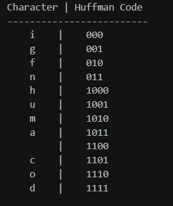

# Experiment 11 – Implementation of Huffman Coding Algorithm

## Name : MUTHUAKASH M

## Register Number : 212225230194

## Aim

To implement the Huffman Coding algorithm in Python to generate variable-length binary codes for characters based on their frequency of occurrence.

## Software Requirements

- Python
- Jupyter Notebook

## Algorithm

1. Get the input string.
2. Calculate the frequency of each character in the input string.
3. Create tree nodes using the characters and their frequencies.
4. Sort the nodes based on frequency.
5. Select the two nodes with the smallest frequencies and combine them into a new node.
6. Repeat the process until a single Huffman tree is formed.
7. Generate binary codes by traversing the Huffman tree.
8. Print the characters and their corresponding Huffman codes.

## Program 1: Get the Input String

```python
input_string = "huffman coding"
```

## Program 2: Calculate Character Frequency

```python
frequency = {}

for char in input_string:
    if char in frequency:
        frequency[char] += 1
    else:
        frequency[char] = 1
```

## Program 3: Create Tree Nodes

```python
nodes = [[char, freq] for char, freq in frequency.items()]
```

## Program 4: Construct the Huffman Tree

```python
while len(nodes) > 1:
    nodes = sorted(nodes, key=lambda x: x[1])

    left = nodes.pop(0)
    right = nodes.pop(0)

    new_node = [[left, right], left[1] + right[1]]
    nodes.append(new_node)

huffman_tree = nodes[0]
```

## Program 5: Generate Huffman Codes

```python
huffman_codes = {}

def generate_codes(tree, code=""):
    if isinstance(tree[0], str):
        huffman_codes[tree[0]] = code
    else:
        generate_codes(tree[0][0], code + "0")
        generate_codes(tree[0][1], code + "1")

generate_codes(huffman_tree)
```

## Program 6: Display Huffman Codes

```python
print("Character | Huffman Code")
print("-------------------------")

for char, code in huffman_codes.items():
    print(f"    {char}    |    {code}")
```

## Output



## Result

Thus, the Huffman Coding algorithm was successfully implemented in Python to generate binary codes for the given input string.